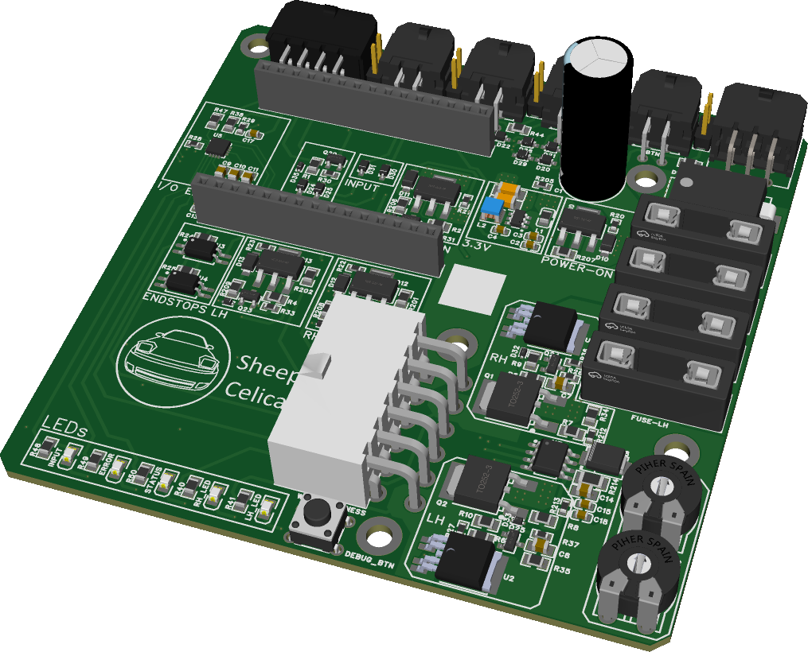

# Hardware Overview

The Pop-up Controller V10 board is designed primarily as a direct replacement for the factory Light Retractor Relay used in Toyota Celica T18 models.

## High-Level Functional Blocks

- ESP32 DevKit V1 for the main control firmware
- internal analog and digital I/O handled through the ADS7138
- optional remote input support through a PCF8574-based external expander
- Revision F ESP32-S3 support for an external remote module with a PCA9536 troubleshooting I/O expander and CC1101 sub-1 GHz radio
- temperature monitoring via an LM75-compatible sensor
- dedicated motor-control and protection hardware for the pop-up motors
- illumination, button, switch, and vehicle-facing input handling

The Revision F ESP32-S3 remote module uses PCA9536 P0 for its active-low pair button and P1-P3 for active-high pair, status, and debug LEDs. The CC1101 uses GPIO42 SCLK, GPIO44 CS, GPIO2 MISO/GDO1, and GPIO1 MOSI. CC1101 GDO0 reaches the controller's shared wake rail through diode logic; normal firmware access is polling-based and does not require a dedicated GDO interrupt. GDO2 directly drives an active-low carrier-activity LED.

## Current Documentation Scope

- this repo documents the firmware-facing view of the hardware
- schematics are not published here at this time
- connector-level installation details are intentionally kept out of the source repo for now

## Related Pages

- [Major Components](major-components.md)
- [I/O and Connectors](io-and-connectors.md)
